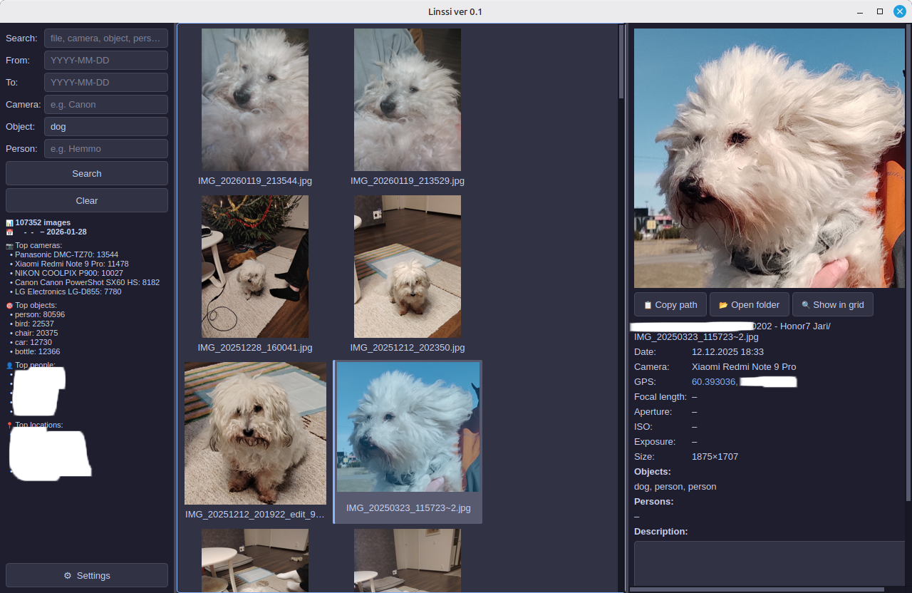
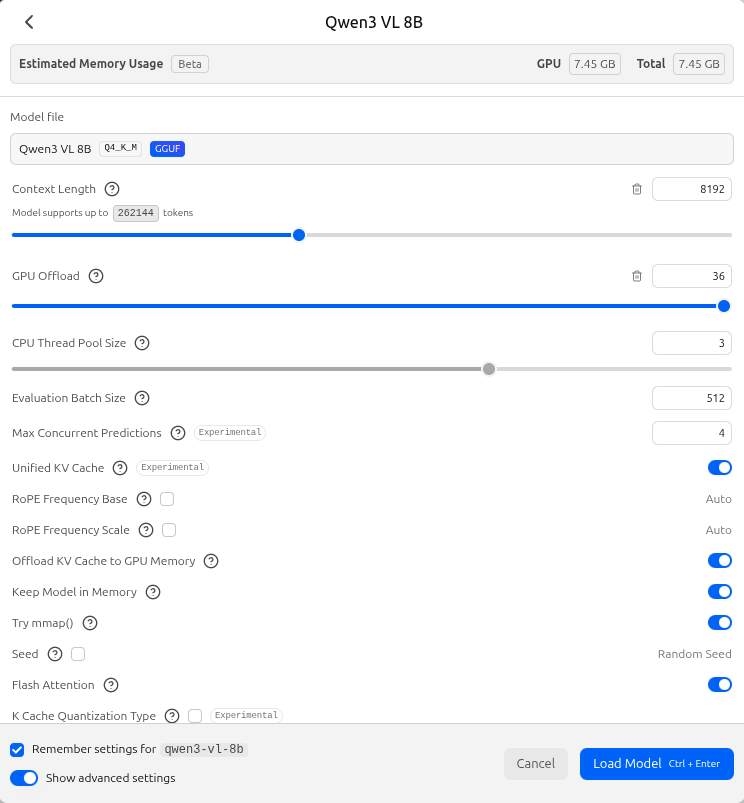

# Linssi v0.2

Local-first photo collection indexer. Scans your image directories and builds a
searchable SQLite database using EXIF metadata, YOLO object detection, face
recognition, and multimodal LLM descriptions — all running on your own GPU.

---

## Repository Overview

This repository contains three components. Each has its own README:

| Component | Description | README |
|-----------|-------------|--------|
| **linssi** (this document) | Indexing pipeline + Qt6 desktop GUI | *(you are here)* |
| **linssi-for-web** | Web-based viewer frontend | [linssi-for-web/README.md](linssi-for-web/README.md) |
| **linssiviewer** | Standalone desktop viewer (no pipeline dependency) | [linssiviewer/README.md](linssiviewer/README.md) |

All three components share the same SQLite database produced by the indexing pipeline.
The viewer and web frontend are read-only; they do not modify the database.

---

## Features

| Stage | What it does |
|-------|--------------|
| **scan** | Walks directories, registers images, deduplicates by partial MD5 hash |
| **exif** | Extracts camera make/model, date, GPS, focal length, aperture, ISO, exposure |
| **yolo** | Detects objects (YOLOv8m: 80 COCO classes) with bounding boxes and confidence |
| **faces** | Identifies known people via face recognition; reference photos in `data/faces/<Name>/` |
| **llm** | Generates natural-language descriptions via a local multimodal model (LM Studio) |
| **gui** | Qt6 three-panel browser with settings dialog: filter → thumbnail grid → detail view |

---

## Requirements

- **Python 3.11** recommended (required for Pascal GPUs — see note below)
- NVIDIA GPU with CUDA support for the indexing pipeline
- [LM Studio](https://lmstudio.ai/) with a multimodal model loaded (e.g. `qwen3-VL-8B`) for the LLM stage
- ~3 GB disk for YOLOv8m weights (downloaded automatically on first run)

> **Pascal GPU users (GTX 1080 Ti, GTX 1070, sm_61 etc.):**
> PyTorch 2.3+ dropped sm_61 support from pre-built wheels.
> The face stage runs on **CPU only** (~1–4 img/s) — this is expected behaviour.

> **Volta+ users (RTX series, sm_70+):**
> Python 3.12 works only with Volta or newer (sm_70+, e.g. RTX series).

> **Running the GUI on a non-CUDA machine:**
> Once the database has been built on a CUDA-capable machine it can be copied to any other PC.
> The GUI (browse, search, filter) reads only from the SQLite file and does not require a GPU.
> The only constraint is that **the absolute paths to the photo files must be identical** on
> both machines (symlinks or bind-mounts work fine). If images have moved, add a secondary
> directory in Settings → Database so the viewer can find them. The indexing pipeline stages
> (YOLO, faces, LLM) still require a CUDA machine to re-index new photos.

---

## Installation

```bash
# 1. Clone
git clone https://codeberg.org/hiltsu/linssi.git
cd linssi

# 2. Run the hardware-aware installer (detects GPU, creates venvs, installs deps). Wait for finish.
bash install.sh

# 3. Start
.venv/bin/python -m src.main --gui
```

`install.sh` detects your GPU compute capability via `nvidia-smi` and creates two
virtual environments:

| GPU | Python | `.venv` (main app) | `.venv-face` (face worker) |
|-----|--------|-------------------|---------------------------|
| **Volta+ (sm_70+)** | 3.12 | torch, ultralytics, PyQt6 | facenet-pytorch + CUDA |
| **Pascal (sm_61)** | 3.11 | torch cu118, ultralytics, PyQt6 | insightface + onnxruntime **CPU** |
| **No GPU** | 3.11 | ultralytics, PyQt6 | insightface + onnxruntime CPU |

Face recognition runs in a **separate subprocess** (`.venv-face`). If it crashes for any
reason, the main app continues with CPU. Check database with DB Browser or sql for errors.

```sql
-- Quick check: stage results summary
SELECT stage, status, COUNT(*) AS n FROM processing_log GROUP BY stage, status ORDER BY stage, status;

-- Face stage errors with file paths
SELECT i.file_path, pl.error_message
FROM processing_log pl
JOIN images i ON pl.image_id = i.id
WHERE pl.stage = 'faces' AND pl.status = 'error'
LIMIT 20;
```

---

## Faultfinding

### Useful SQL queries

Open the database with `sqlite3 data/linssi.db` or DB Browser for SQLite.

**Stage progress overview**

```sql
SELECT stage,
       SUM(CASE WHEN status = 'done'  THEN 1 ELSE 0 END) AS done,
       SUM(CASE WHEN status = 'error' THEN 1 ELSE 0 END) AS errors,
       COUNT(*) AS total
FROM processing_log
GROUP BY stage
ORDER BY stage;
```

**List all errors for a stage** (replace `'faces'` with `'yolo'`, `'exif'`, `'llm'` etc.)

```sql
SELECT i.file_path, pl.error_message
FROM processing_log pl
JOIN images i ON pl.image_id = i.id
WHERE pl.stage = 'faces' AND pl.status = 'error'
ORDER BY i.file_path;
```

**Find orphaned rows** (child rows whose parent image has been deleted)

```sql
SELECT 'exif_data'       AS tbl, COUNT(*) AS orphans FROM exif_data       WHERE image_id NOT IN (SELECT id FROM images)
UNION ALL
SELECT 'yolo_detections',         COUNT(*)             FROM yolo_detections  WHERE image_id NOT IN (SELECT id FROM images)
UNION ALL
SELECT 'face_detections',         COUNT(*)             FROM face_detections  WHERE image_id NOT IN (SELECT id FROM images)
UNION ALL
SELECT 'llm_descriptions',        COUNT(*)             FROM llm_descriptions WHERE image_id NOT IN (SELECT id FROM images);
```

**Images not yet processed by a stage** (useful after adding new photos)

```sql
SELECT COUNT(*) AS unprocessed
FROM images
WHERE id NOT IN (
    SELECT image_id FROM processing_log WHERE stage = 'yolo' AND status = 'done'
);
```

**Persons found and how many images each appears in**

```sql
SELECT person_name, COUNT(DISTINCT image_id) AS images
FROM face_detections
GROUP BY person_name
ORDER BY images DESC;
```

**Most common YOLO-detected objects**

```sql
SELECT class_name, COUNT(*) AS detections
FROM yolo_detections
GROUP BY class_name
ORDER BY detections DESC
LIMIT 20;
```

---

## Configuration

The application loads configuration in this order (first found wins):

1. `--config <path>` CLI argument
2. `config.local.yaml` in the project root *(gitignored — your personal settings)*
3. `config.yaml` *(default template, committed to the repo)*

The easiest way to configure Linssi is through the **GUI Settings dialog** (⚙ button
at the bottom of the left panel). It writes your changes directly to `config.local.yaml`.

To configure manually, copy `config.yaml` to `config.local.yaml` and edit:

```yaml
image_dirs:
  - ~/Pictures
  - /mnt/usb/photos

yolo:
  model: yolov8m.pt      # n/s/m/l/x — medium is a good balance
  confidence: 0.35
  device: 0              # 0 = first GPU, "cpu" = CPU

faces:
  reference_dir: data/faces
  similarity_threshold: 0.45
  model_name: buffalo_l

llm:
  api_url: http://localhost:1234/v1/chat/completions
  model: qwen3-VL-8B
  prompt: "Describe this photo in detail."
  timeout: 60
  max_retries: 3
  max_tokens: 512
  image_max_side: 512
  threads: 2             # parallel requests to LM Studio (1–4)
```

---

## GUI Settings Reference

| Tab | Key controls |
|-----|-------------|
| **General** | Image source directories; scan on startup toggle |
| **YOLO** | Model size (n/s/m/l/x), confidence threshold, CUDA device |
| **Faces** | Reference photos directory, similarity threshold, model name; **Show stored faces** button to browse all recognised persons and their detected image appearances |
| **LLM** | API URL, model name, prompt text, timeout, max retries, **max tokens**, **image resize (px)**, **LLM threads** (1–4 parallel requests) |
| **Database** | Database location and status; **secondary image directories** (fallback paths when originals have moved); **LLM description search & replace** (fix LM Studio artefacts in bulk); backup, VACUUM, rebuild indexes, cleanup orphaned entries |
| **Processing** | **Skip / re-process toggle** — when unchecked ("Do not skip"), all images are re-processed even if already done (equivalent to `--force` on the CLI); batch size; max workers; **Limit (testing)** for dry runs; CUDA device info; one-click pipeline stage buttons (**Scan Images**, **Scan EXIF**, **Learn & Identify Faces**, **Start LLM Vision**) with live output, progress bar, and Cancel — Start LLM Vision is automatically disabled if LM Studio is not running |

> Pipeline stages (YOLO, faces, LLM) pick up the new settings on their next run.



---

## Project Structure

```
install.sh             — Hardware-aware installer: detects GPU, creates .venv + .venv-face
src/
  main.py              — CLI entry point (argparse); LLM stage uses ThreadPoolExecutor
  config.py            — YAML config with dataclasses (incl. max_tokens, image_max_side, threads)
  database.py          — SQLite: images, exif, yolo, faces, llm, log, secondary_dirs tables
  pipeline/
    base.py            — Abstract PipelineStage with error tracking
    exif_reader.py     — Pillow EXIF + GPS extraction
    yolo_detector.py   — YOLOv8 object detection
    face_recognizer.py — Spawns face_worker.py subprocess; sends image paths, receives JSON results
    face_worker.py     — Runs in .venv-face; loads backend, builds embeddings, identifies faces
    llm_describer.py   — LM Studio vision API (OpenAI-compatible, configurable threads)
    scanner.py         — Directory walker + file hashing
    face/
      face_backend.py        — FaceBackend Protocol + FaceResult dataclass
      insightface_backend.py — InsightFace backend (CPU/GPU with safe CUDA subprocess test)
      facenet_backend.py     — facenet-pytorch backend (Volta+ CUDA)
  gui/
    main_window.py     — QMainWindow, splitter layout
    filter_panel.py    — Search/filter controls with autocomplete, Limit spinbox, ⚙ button
    thumbnail_grid.py  — Async thumbnail loader (QThreadPool), remove_image(), dynamic page size
    detail_panel.py    — Large preview + full metadata + Delete button
    settings_dialog.py — Tabbed settings dialog, writes config.local.yaml
config.yaml            — Default configuration template
config.local.yaml      — Your local overrides (gitignored, written by GUI)
data/faces/            — Reference photos: data/faces/<Name>/*.jpg  (gitignored)
data/                  — SQLite database  (gitignored)
.venv/                 — Main app virtualenv (created by install.sh)
.venv-face/            — Face worker virtualenv, isolated (created by install.sh)
linssi-for-web/        — Web-based viewer — see linssi-for-web/README.md
linssiviewer/          — Standalone desktop viewer — see linssiviewer/README.md
```

---

## Database Schema

| Table | Contents |
|-------|----------|
| `images` | file path, partial MD5 hash, file size |
| `exif_data` | camera make/model, date, GPS, focal length, aperture, ISO, exposure, dimensions (`raw_json` column exists for schema compatibility but is always NULL) |
| `yolo_detections` | class name, confidence, bounding box per detection |
| `face_detections` | person name, confidence, bounding box, embedding |
| `llm_descriptions` | generated text, model name |
| `processing_log` | per-image stage status — enables resumable batch processing |
| `secondary_dirs` | fallback directories for images that have moved from their original path |

---

## LM Studio Configuration

The LLM stage sends each image to a locally running LM Studio instance via its OpenAI-compatible
API. Getting the settings right has a significant impact on both speed and description quality.

### Image resizing

Before sending an image to the model, the pipeline resizes it so that the longest side is at
most **512 pixels**. This is intentional:

- Multimodal models tile the input image into vision tokens. A full-resolution photo can
  produce thousands of vision tokens, consuming most of the context window and slowing
  inference considerably.
- 512 px is sufficient for scene understanding, object identification, and natural-language
  description — the model does not need pixel-perfect detail.
- Smaller payload = fewer vision tokens = faster time-to-first-token and lower overall
  latency per image.

### Key LM Studio settings

| Setting | Recommended value | Notes |
|---------|------------------|-------|
| **Context Length** | 8192 | **Critical.** The default (512) leaves almost no room after vision tokens are consumed, causing truncated or poor descriptions. Set to at least 4096; 8192 is a safe choice. |
| **GPU Offload** | Maximum (all layers) | Load all model layers onto the GPU. With a 8 B model at Q4_K_M quantisation, full offload typically requires ~7.5 GB VRAM. |
| **Flash Attention** | On | Reduces VRAM pressure and speeds up attention computation. |
| **Offload KV Cache to GPU** | On | Keeps the KV cache on VRAM; avoids slow CPU↔GPU transfers during generation. |
| **Keep Model in Memory** | On | Prevents the model from being unloaded between API calls — essential for batch processing. |
| **Max Concurrent Predictions** | 4 (default) | LM Studio supports parallel requests. Set **LLM threads** (1–4) in Settings → LLM to match — the pipeline sends that many images concurrently via a thread pool. |

### GPU memory requirements by model size

| Model | Quantisation | VRAM needed | Fits on |
|-------|-------------|-------------|---------|
| Qwen3-VL 8B | Q4_K_M | ~7.5 GB | GTX 1080 Ti (11 GB), RTX 3080 10 GB* |
| Qwen3-VL 8B | Q8 | ~9.5 GB | GTX 1080 Ti (11 GB), RTX 3080 12 GB |
| Qwen2.5-VL 7B | Q4_K_M | ~6.5 GB | Most 8 GB cards |
| Llava 13B | Q4_K_M | ~9 GB | GTX 1080 Ti (11 GB) |

> \* RTX 3080 10 GB has less VRAM than the 12 GB variant — check available VRAM before loading.

### Effect of Context Length on speed

During real-world testing on a GTX 1080 Ti, setting Context Length to 512 (LM Studio default)
produced ~7.8 s/image. Raising it to 8192 dropped latency to ~3.4 s/image — a 56% improvement.
The likely cause: with only 512 tokens available, the model stalls trying to fit vision tokens
and prompt into an insufficient window. A properly sized context allows the KV cache and
attention mechanism to operate as intended.

---

## Tested with

The following numbers are from a real-world collection indexed on an **NVIDIA GTX 1080 Ti
(11 GB VRAM, sm_61, system CUDA 12.2, PyTorch 2.2.2 cu118)**, Ubuntu 24.04, Python 3.11:

| Table | Row count | Notes |
|-------|-----------|-------|
| `images` | 107 352 | unique files after MD5 deduplication |
| `exif_data` | 107 854 | slightly higher — artefact of early test runs before the `/home/jari/Pictures` directory was removed and orphaned entries cleaned up via Settings → Database → Cleanup |
| `yolo_detections` | 107 854 | same artefact as exif_data |
| `face_detections` | 107 650 | ~200 images failed face analysis (corrupt or unsupported files) |
| `llm_descriptions` | 104 060 | LLM stage run at scale — see pipeline throughput below |

> **Why do some row counts exceed the image count?**
> During early development a test directory (`/home/jari/Pictures`) was indexed and later
> deleted from disk. The database entries for those images were not removed at the time,
> leaving a small number of orphaned rows in the child tables. Use
> **Settings → Database → Cleanup orphaned entries** to remove them.

### Pipeline throughput on GTX 1080 Ti

| Stage | Throughput | Notes |
|-------|-----------|-------|
| **scan** | ~57 images/s | I/O bound; depends on storage speed |
| **yolo** | — | Not measured separately |
| **llm** | ~3.4 s/image (~0.29 images/s) | Qwen3-VL 8B Q4_K_M, Context 8192, images resized to 512 px, `temperature=0.3`, `max_tokens=512` |

At 3.4 s/image the full LLM stage over 104 000 images takes approximately **4 days** of
continuous processing. The stage is fully resumable — you can stop and restart at any time
without reprocessing already-described images.

> **LM Studio Context Length matters.** Running with the default Context Length of 512
> produced ~7.8 s/image on the same hardware. Raising it to 8192 reduced latency to
> ~3.4 s/image — a 56% speed improvement. Always set Context Length to at least 4096
> when running vision models for batch inference.



---

## Privacy & Ethics

Linssi is designed as a **local-first** tool — no data ever leaves your machine.
All processing (YOLO, face recognition, LLM descriptions) runs on your own GPU,
and the database remains on your local filesystem.

That said, face recognition raises ethical considerations worth keeping in mind:

- **Obtain consent** — only add reference photos of people who have agreed to be
  recognised. Children cannot meaningfully consent; parental permission is a
  minimum, not a substitute.
- **Protect your database** — the SQLite database and face embeddings are sensitive.
  Ensure backups are encrypted and that the data does not end up on shared or
  sold hardware.
- **Scope creep** — it is easy to expand a personal photo tool into something
  broader. Be intentional about who and what you index.

Linssi is intended for personal, private use within your own photo collection.
It is not designed or tested for surveillance, commercial identification, or
any use involving people who have not consented.

---

## License

MIT — see [LICENSE](LICENSE).

---

