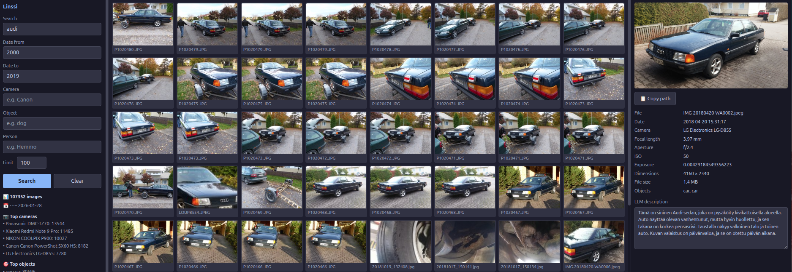
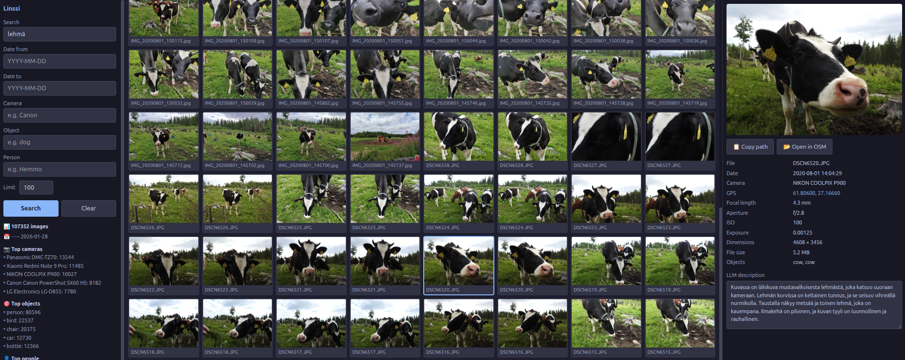
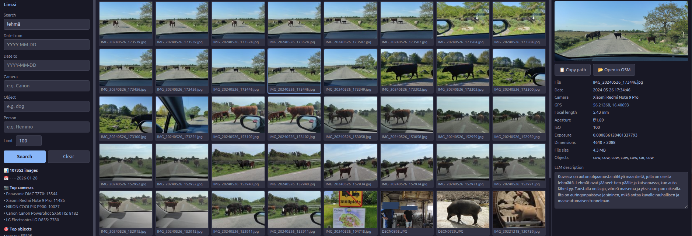
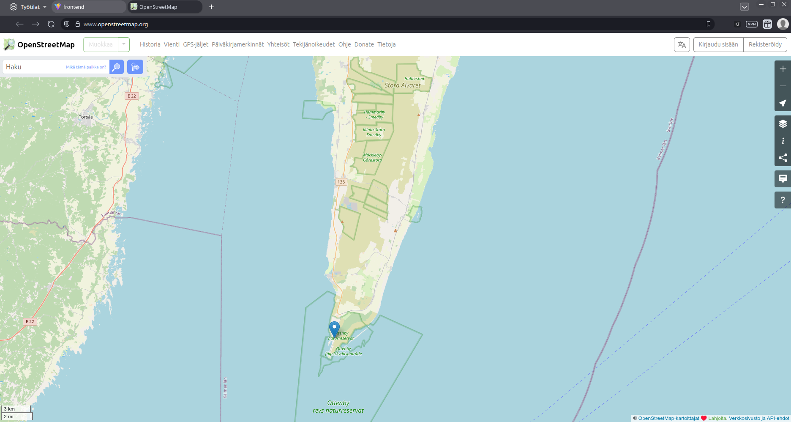

# Linssi For Web v0.2.0

Browser-based viewer for Linssi ML pipeline image databases. Replaces the PySide6 desktop app with a FastAPI backend and React SPA frontend.

## Related projects

- **[Linssi](https://codeberg.org/hiltsu/linssi)** — the main ML pipeline that creates the database. Requires a CUDA-capable GPU. Run this first to analyse your images and produce the `image_analyzer.db` file that Linssi Web reads.
- **[LinssiViewer](https://codeberg.org/hiltsu/linssiviewer)** — lightweight PySide6 desktop viewer for the same database, CPU-only, no web server needed.

> **Note:** Linssi Web is a read-only viewer. The database must be created with [Linssi](https://codeberg.org/hiltsu/linssi) before this application can be used.




## Requirements

- Python 3.12+
- Node.js 18+
- nginx (production)

## Backend — development

```bash
cd backend
pip install -r requirements.txt
LINSSI_DB=/path/to/image_analyzer.db uvicorn main:app --host 0.0.0.0 --port 8000 --reload
```

Alternatively pass the database path as a CLI argument:

```bash
uvicorn main:app --host 0.0.0.0 --port 8000 -- --db /path/to/image_analyzer.db
```

## Frontend — development

```bash
cd frontend
npm install
npm run dev        # http://localhost:5173, proxies /api to :8000
```

## Production deployment (e.g. Raspberry Pi)

### 1. Install dependencies

```bash
sudo apt update && sudo apt install -y python3 python3-venv python3-pip nodejs npm nginx git
```

### 2. Create a service user

```bash
sudo useradd -r -s /usr/sbin/nologin -d /opt/linssi-web -M linssi
```

### 3. Clone and build

```bash
sudo mkdir -p /opt/linssi-web
sudo chown linssi:linssi /opt/linssi-web
git clone https://codeberg.org/hiltsu/linssi-for-web.git /opt/linssi-web
sudo chown -R linssi:linssi /opt/linssi-web

# Backend
sudo -u linssi bash -c 'cd /opt/linssi-web/backend && python3 -m venv venv && source venv/bin/activate && pip install -r requirements.txt'

# Frontend
sudo -u linssi bash -c 'cd /opt/linssi-web/frontend && npm install && npm run build'
```

### 4. Database setup

The Linssi SQLite database must be accessible to the `linssi` user. If the database was created in WAL mode, convert it to DELETE journal mode for read-only access:

```bash
python3 -c "
import sqlite3
conn = sqlite3.connect('/path/to/image_analyzer.db')
conn.execute('PRAGMA wal_checkpoint(TRUNCATE)')
conn.execute('PRAGMA journal_mode=DELETE')
conn.close()
"
```

If the image files are owned by another user, add `linssi` to that user's group:

```bash
sudo usermod -aG <image-owner> linssi
```

### 5. Systemd service

Create `/etc/systemd/system/linssi-web.service`:

```ini
[Unit]
Description=Linssi Web Backend
After=network.target

[Service]
User=linssi
Group=linssi
Environment=LINSSI_DB=/path/to/image_analyzer.db
WorkingDirectory=/opt/linssi-web/backend
ExecStart=/opt/linssi-web/backend/venv/bin/uvicorn main:app --host 127.0.0.1 --port 8000
Restart=always

[Install]
WantedBy=multi-user.target
```

If the database resides on an external drive, add the mount unit as a dependency:

```ini
After=network.target mnt-drive.mount
```

Enable and start:

```bash
sudo systemctl daemon-reload
sudo systemctl enable --now linssi-web.service
```

### 6. Nginx reverse proxy

Create `/etc/nginx/sites-available/linssi-web`:

```nginx
server {
    listen 80;
    server_name your-hostname;

    root /opt/linssi-web/frontend/dist;
    index index.html;

    location /api/ {
        proxy_pass http://127.0.0.1:8000;
    }

    location / {
        try_files $uri $uri/ /index.html;
    }
}
```

Enable and start:

```bash
sudo ln -s /etc/nginx/sites-available/linssi-web /etc/nginx/sites-enabled/
sudo rm /etc/nginx/sites-enabled/default
sudo nginx -t
sudo systemctl enable --now nginx
```

### 7. Updating

```bash
sudo systemctl stop linssi-web.service
cd /opt/linssi-web
sudo -u linssi git pull

# Rebuild frontend
sudo -u linssi bash -c 'cd /opt/linssi-web/frontend && npm run build'

# If backend dependencies changed (requirements.txt)
sudo -u linssi bash -c 'cd /opt/linssi-web/backend && source venv/bin/activate && pip install -r requirements.txt'

sudo systemctl start linssi-web.service
```

## TODO

- [ ] Multiple database support — select which database to view (e.g. personal photos, genealogy photos)
- [ ] Graceful error handling for missing/inaccessible image files (return placeholder instead of 500)

## Contributors

- **Jari Hiltunen** ([hiltsu](https://codeberg.org/hiltsu)) — author
- **Claude** (Anthropic) — code generation and deployment assistance

## License

MIT License — see [LICENSE](LICENSE)

© 2026 Jari Hiltunen, Codeberg: [hiltsu](https://codeberg.org/hiltsu)






